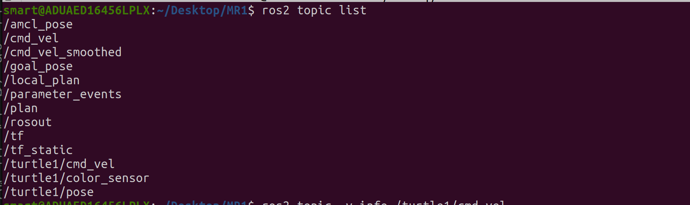
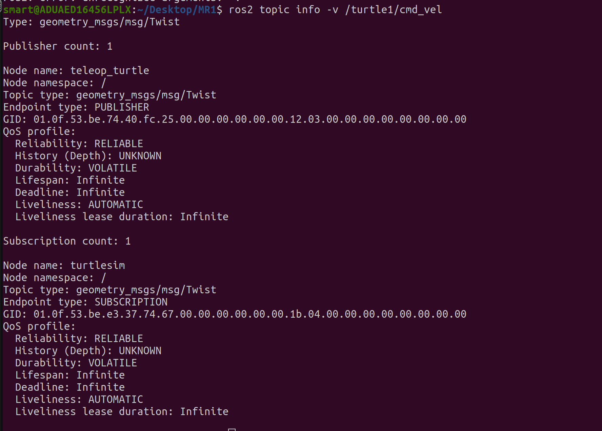

# MR_Exercise1-

## Task 1

### 1. What is the name of the publisher node?

The publisher node is **`teleop_turtle`**. It publishes velocity commands on `/turtle1/cmd_vel`, which the `turtlesim` node subscribes to.

Commands used:

```bash
ros2 node list
ros2 topic info -v /turtle1/cmd_vel
```




### 2. What is the message type of /cmd_vel?


### 3. What is the frequency of publication of the node publishing on /cmd_vel?
We can not say for sure unless we measure it, but currently it doesnt have a set frequency. it is based on every key press

### 4. What is the message type of /turtle1/pose?


### 5. Give an example of a message that is being published on /turtle1/color_sensor. Display the contents of the topic in a terminal
window and copy-paste.
